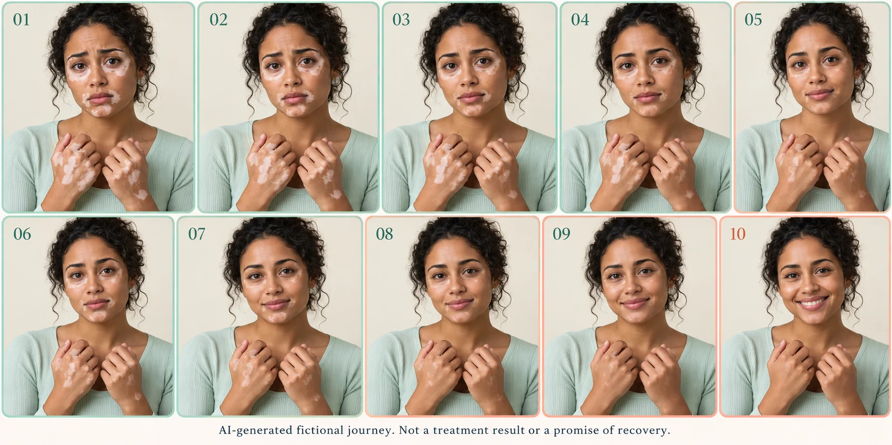

# WIFA VitiTrack

I started VitiTrack after living with vitiligo myself. When I compared photos of my hands, I sometimes found it hard to tell whether my skin had changed or whether the light was different.

The app gives people a place to keep their photos, write down their care and prepare a report for their dermatologist. I built this prototype during the AMD Developer Hackathon: ACT III in Milan, on 17 and 18 October 2026.

William Farokhzad, [WIFA Robotics](https://wifarobotics.com/)

[Try the app](https://wifa-vititrack.williamfar.chatgpt.site)

[Hackathon details](https://lablab.ai/ai-hackathons/amd-developer-hackathon-act-iii)

## An imagined journey



This sequence was generated with AI for the project artwork. It imagines gradual repigmentation and a change in expression. It is not a patient's treatment history, a result produced by VitiTrack or a promise of recovery.

## Using the app

You can explore the demo without an account. The interface is in Italian.

Open “Volti e percorsi” to browse the example profiles. Select “Analizza mani” to open a hand photo in the editor. Outline the area you want to follow, then review the proposed white patches. You can also draw the patches yourself.

If a ruler is visible in the photo, you can use it to estimate dimensions. It needs to be in the same plane as the skin being measured. Add your observation to the diary, record the care you have followed and prepare a report to discuss with your doctor.

The app has patient, doctor and public research views. Switching between them changes the demo interface; access to saved medical records is checked separately on the server.

On an iPhone, open the app in Safari, tap Share and choose Add to Home Screen. An Apple Developer account is not needed to demonstrate it this way. The app needs an internet connection.

## Photos and measurements

The ten example people are fictional. Their face and hand images were generated with AI, and their names and countries were assigned for the demo. The starting charts and public statistics are also invented. They do not show a real patient's progress or prove that a treatment works.

The editor runs in the browser. It resizes the image, converts it to JPEG and looks for bright areas with little colour inside the region you selected. You need to check the result. The area calculation handles overlapping patches and clips them to your selected region. Ruler calibration adds approximate physical dimensions.

These measurements are experimental. Lighting, skin tone, camera settings, hand position and skin curvature can affect them. They are not a diagnosis or a validated score such as VASI. No clinical trial or accuracy study has been carried out for this prototype.

## AMD, Google Gemma and Evolus

The plan is to use Google Gemma running on AMD to turn diary entries into a draft visit summary. Evolus would support a reference library and a workflow that prepares the report for human review.

The server routes for these integrations are written, but successful live calls have not yet been verified. The exact Gemma model, AMD endpoint and Evolus workspace still need to be configured and tested. The current image measurements run locally in the browser.

The app also includes a care diary, an editable report and a small collection of research links. The research collection was checked on 17 October 2026. It includes a PubMed search link for newer papers, but it does not update automatically.

See [the submission notes](docs/HACKATHON.md) for the remaining event requirements and [the architecture notes](docs/ARCHITECTURE.md) for the implementation.

## Running locally

Use Node.js 24 and pnpm 11.25.0. You can install pnpm with `npm install --global pnpm@11.25.0`.

Clone the repository:

```bash
git clone https://github.com/williamfarokhzad/VITITRACK.git
cd VITITRACK
pnpm install --frozen-lockfile
pnpm run dev:portable
```

If you downloaded the source ZIP, extract it and run the same commands from the VITITRACK folder, starting with `pnpm install --frozen-lockfile`.

Open http://localhost:5173. The example gallery, photo editor and local reports work without API keys.

Local development includes a mock account, `seedy@sites.test`, restricted to loopback access. To try saving records with that account, initialize the local database first:

```bash
pnpm run build:portable
pnpm run db:local
pnpm run dev:portable
```

Run `db:local` once to create the initial local schema. Use test data for local development.

## Running with Docker

```bash
docker compose up --build
```

Open http://localhost:8080. You can also build and run it directly:

```bash
docker build -t vititrack .
docker run --rm -p 127.0.0.1:8080:8080 vititrack
```

The container runs the built app in Wrangler's local Cloudflare emulator. It supports the anonymous demo. Saved records, clinician sharing and authenticated AI requests depend on the hosted sign-in and storage setup. The container discards incoming identity headers because it has no trusted sign-in gateway.

Docker was not available in the development environment, so the image itself has not been tested. The underlying app build and emulator checks passed. Details are in [the validation notes](docs/VALIDATION.md).

## Server configuration

The live app uses ChatGPT Sites for sign-in, D1 for records and R2 for photos. A patient can grant access to one clinician from a verified server-side allowlist and revoke it later. The complete flow with two real accounts still needs testing.

Use `.env.example` as a reference and keep actual values in your server's secret settings or an ignored local environment file.

| Variable | Purpose |
| --- | --- |
| `AMD_API_KEY` | Key for the approved AMD endpoint |
| `AMD_BASE_URL` | OpenAI-compatible base URL, including `/v1` |
| `AMD_MODEL` | Exact Gemma model ID available on that endpoint |
| `EVOLUS_API_KEY` | Evolus API key |
| `EVOLUS_APPLICATION_ID` | Event workspace application ID |
| `EVOLUS_AGENT_ID` | Configured agent ID |
| `EVOLUS_WORKFLOW_ID` | Report workflow ID |
| `CLINICIAN_EMAILS` | Comma-separated list of independently verified clinician emails |

`/api/report` sends structured observations to the configured model. It does not send the original photos. `/api/evolus` supports agent chat and workflow calls. Check the workflow's `{text: ...}` input against the schema in your Evolus workspace before using it.

`/api/integrations` shows whether settings are present. It does not confirm that a service has responded successfully.

If you host the app outside Sites, you will need a verified authentication gateway and your own storage configuration. Do not accept user-supplied `oai-authenticated-user-*` headers as proof of identity. Never commit API keys.

## Development checks

```bash
pnpm test
pnpm run typecheck
pnpm run build:portable
```

The main interface is in `app/viti-app.tsx`. Server routes are in `app/api/`. The measurement code and tests are in `lib/geometry.mjs` and `tests/geometry.test.mjs`. Database definitions are in `db/` and `drizzle/`, and the example images are in `public/demo-people/`.

## Before use with patients

VitiTrack is a prototype for documenting observations and preparing conversations with a doctor. It does not prescribe care or compare treatments for effectiveness. A clinical release would need validation across skin tones, reviewed consent and privacy information, retention and deletion controls, and a security review.

No doctor or event partner is presented as endorsing the project. Any clinical collaboration will be named only with that person's consent.

## License

The project code is released under the [MIT license](LICENSE), copyright 2026 William Farokhzad / WIFA Robotics. Upstream notices are listed in [THIRD_PARTY_NOTICES.md](THIRD_PARTY_NOTICES.md). Linked articles and any separately obtained model weights keep their own licenses. This repository does not include Gemma weights.

## Short video

The ten fictional portraits are also available as a [14.5-second MP4](public/story/fictional-journey-10-steps.mp4), with soft transitions. The demo home page and gallery show it alongside the complete image. Both include a disclosure that the sequence is fictional and does not show treatment results.

## Phone diary and stabilized video

The home screen now follows the supplied mobile design with four diary tabs, latest photo, monthly calendar, timeline and visit preparation. The mint and lavender layout works as a responsive web app and can be added to an iPhone Home Screen. The 14.4-second portrait sequence uses eye-region registration and scale normalization to keep the face centered. Artwork captions have been removed from the cover and contact sheet; the story remains described as a fictional simulation beside the video.
